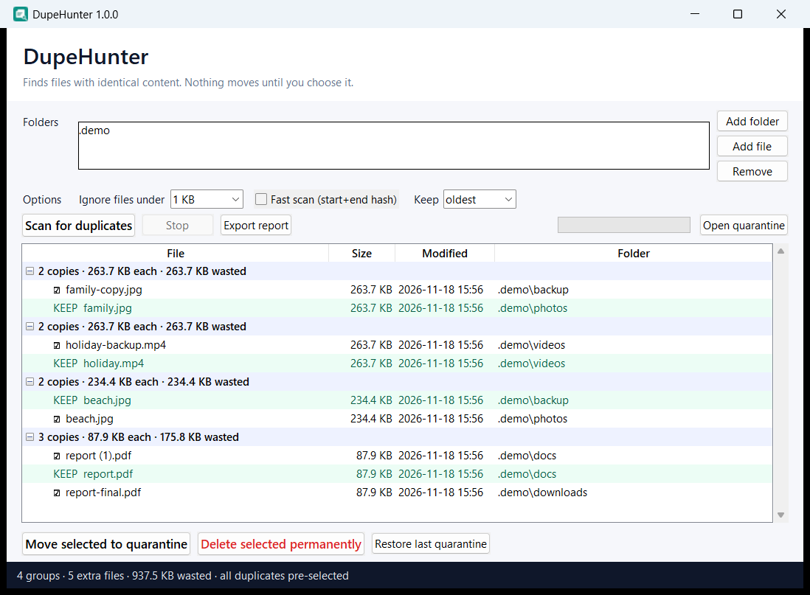

# DupeHunter

**Find files with identical content on Windows — review them, then clean up safely.**

Day 2 of **30 Windows tools in 30 days** · 100% open source (MIT)

[](https://github.com/hassanelsayed91/dupehunter/actions/workflows/ci.yml)




---

## The problem

Disk fillers are not files with the same name — they are the same **bytes** saved under
`report.pdf`, `report (1).pdf` and `report-final-FINAL.pdf`. Comparing names misses them,
comparing sizes gives false positives, and most "cleaner" apps ask you to trust an
algorithm that deletes first and explains later.

DupeHunter shows every group of identical files, tells you exactly how much space is
wasted, and **moves nothing until you pick the checkboxes**. Removal goes to a quarantine
folder with a journal, so one command puts everything back.

## Features

- **Content, not names.** BLAKE2b hashing in 1 MiB chunks; same name is irrelevant, same bytes is everything.
- **Two-stage scan.** Group by size first (instant), hash only the files that could possibly match.
- **Review before action.** GUI checkboxes default to "keep the oldest, remove the rest" — and every box is yours to change.
- **Quarantine, not delete.** Extra copies go to `~/DupeHunter Quarantine/<timestamp>` with a journal; `dupehunter restore` undoes the whole run.
- **Verified before it acts.** Fast scans are re-checked with a full hash before one byte moves, so a sampling shortcut can never cost you a file.
- **Hard links understood.** A second link to the same file is not a duplicate and is never reported.
- **Fast mode for huge libraries.** Hashes only the start+end of each file, with verification kept for the cleanup step.
- **Reports.** Export JSON or CSV for auditing before you clean.
- **No dependencies, no installation, no telemetry.** Standard library only, Tkinter GUI included.

## Quick start

```powershell
git clone https://github.com/hassanelsayed91/dupehunter.git
cd dupehunter

python -m dupehunter gui             # desktop app
python -m dupehunter scan "D:\Photos"  # report only, changes nothing
```

Requires Python 3.10+ on Windows. Nothing to `pip install`.

### No Python? Build the .exe

```powershell
.\build.ps1     # -> dist\DupeHunter.exe (GUI) + dist\DupeHunter-CLI.exe
.\install.ps1   # copies to %LOCALAPPDATA%\Programs\DupeHunter + shortcuts
```

### Command line

```powershell
# 1. Look first - read-only
python -m dupehunter scan "D:\Photos" "D:\Backups"

# Only bother with files bigger than 5 MB, save a report
python -m dupehunter scan "D:\Photos" --min-size 5MB --json report.json --csv report.csv

# 2. See the plan without touching anything
python -m dupehunter clean "D:\Photos" --keep oldest --dry-run

# 3. Quarantine the extra copies (reversible)
python -m dupehunter clean "D:\Photos" --keep oldest

# 4. Changed your mind?
python -m dupehunter restore

# Permanent removal, only when you really mean it
python -m dupehunter clean "D:\Photos" --delete
```

Example output:

```text
DupeHunter 1.0.0 - find real duplicates, remove them safely

  folder: D:\Photos

  scanned 1152 file(s) in 3.4s (214 compared, 0 unreadable)

  4 duplicate group(s) · 5 extra file(s) · 937.5 KB wasted

  [1] 2 copies · 263.7 KB each · 263.7 KB wasted
      dup   2026-11-18 15:56  D:\Photos\backup\family-copy.jpg
      keep  2026-11-18 15:56  D:\Photos\family.jpg

  [2] 3 copies · 87.9 KB each · 175.8 KB wasted
      dup   2026-11-18 15:56  D:\Photos\docs\report (1).pdf
      keep  2026-11-18 15:56  D:\Photos\docs\report.pdf
      dup   2026-11-18 15:56  D:\Photos\downloads\report-final.pdf
```

## How it works

1. **Walk** the folders, skipping hidden/system files, temp files and excluded folders
   (`node_modules`, `.git`, ...). Hard links are collapsed so one file is counted once.
2. **Bucket by size.** A file with a unique size cannot have a duplicate, so it is never hashed.
3. **Hash the rest** with BLAKE2b — the whole file, or its head+tail in `--fast` mode.
4. **Group** by `(size, hash)` and sort by wasted space.
5. **Verify** with a full hash of every file before a move or delete.
6. **Act**: quarantine (journaled, reversible) or delete (explicit, confirmed).

## Keep policies

| Policy | Keeps | Good for |
| --- | --- | --- |
| `oldest` *(default)* | the copy with the earliest modified time | original downloads, first import |
| `newest` | the most recently modified copy | edited/latest versions |
| `shortest` | the copy with the shortest full path | stripping `backup/copy of/` noise |
| `first` | the alphabetically first path | predictable, scriptable behaviour |

In the GUI you are not bound by the policy: tick or untick any single file. The survivor
row is marked `KEEP` and cannot be ticked, so a group can never lose all its copies.

## Safety guarantees

| Guarantee | How |
| --- | --- |
| Scanning changes nothing | the scan path only opens files for reading |
| Only real duplicates | full content hash, verified again before acting |
| Nothing is overwritten | quarantine collisions become `name (1).ext` |
| Removal is reversible | quarantine journal, `dupehunter restore` puts every file back |
| Hard links are safe | same physical file is skipped, reported as one |
| Delete is explicit | separate `--delete` flag and a confirmation prompt |
| One failure is not fatal | locked files are counted and skipped, the run continues |

## Reports

`--json` writes the full structure (roots, timings, groups, per-file hashes, totals);
`--csv` writes one row per file with a `keep` column. The GUI's **Export report** button
produces either format.

## Development

```powershell
python -m pytest -q          # 40 tests, standard library only
python tools/make_icon.py    # rebuild the icon (needs Pillow)
python tools/screenshot.py   # rebuild the README screenshot (needs Pillow)
```

Project layout:

```text
dupehunter/
  core.py      scanning, hashing, policies, quarantine, restore, reports
  cli.py       scan / clean / restore / journals / gui
  gui.py       Tkinter desktop app with per-file review
tests/         40 unit tests
tools/         icon + screenshot helpers (dev only)
build.ps1      PyInstaller builds
install.ps1    per-user install with Desktop + Start Menu shortcuts
```

## Contributing

Issues and pull requests are welcome. Keep the project dependency-free (standard library
only) and add a test for any behaviour change — especially anything that deletes a file.

## License

MIT © 2026 Hassan Elsayed

---

## بالعربي

**DupeHunter** أداة ويندوز مفتوحة المصدر بتلاقي الملفات المتكررة الحقيقية — يعني نفس
**المحتوى** مش نفس الاسم — وتوريك حجم المساحة المهدورة قبل أي حاجة.

**المشكلة:** الملفات اللي بتاكل مساحة مش نسخ بنفس الاسم، دي نفس الملف محفوظ باسم
`report.pdf` و`report (1).pdf` و`report-final.pdf`. المقارنة بالأسماء بتفوتها، والمقارنة
بالحجم بتدي نتائج غلط، وأدوات التنظيف بتطلب منك تثق فيها وهي بتحذف الأول وبتشرح بعدين.

**الحل:** الأداة بتحسب بصمة المحتوى (BLAKE2b) وبتعرض كل مجموعة ملفات متطابقة، وأنت اللي
تحدد مين يتشال — ومفيش ملف بيتحرك غير لما تختاره بنفسك.

```powershell
python -m dupehunter scan "D:\Photos"          # معاينة فقط، مش بيغيّر حاجة
python -m dupehunter clean "D:\Photos" --dry-run  # خطة التنظيف بدون تنفيذ
python -m dupehunter clean "D:\Photos"         # نقل للحجر الصحي (قابل للاسترجاع)
python -m dupehunter restore                   # رجّع كل حاجة زي ما كانت
```

**الأمان:** الحذف مش هو الافتراضي — النسخ الزيادة بتتنقل لمجلد حجر صحي مع سجل، وأمر واحد
بيرجّعها. وكل عملية نقل أو حذف بتتعاد فيها البصمة الكاملة قبل التنفيذ، فالفحص السريع
(`--fast`) ما يقدرش يخسّرك ملف. والحذف النهائي محتاج `--delete` + تأكيد.

اليوم التاني من تحدي **30 أداة ويندوز في 30 يوم** — كل أداة مستودع مستقل بترخيص MIT.

الترخيص: MIT © 2026 حسن السيد
